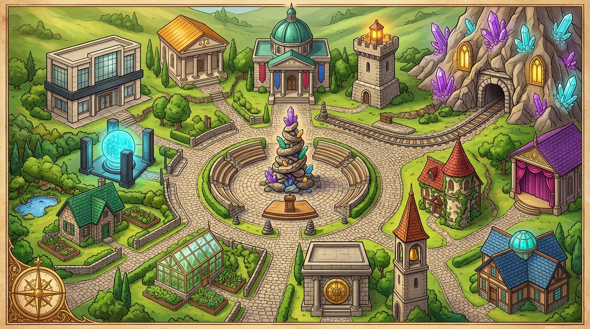
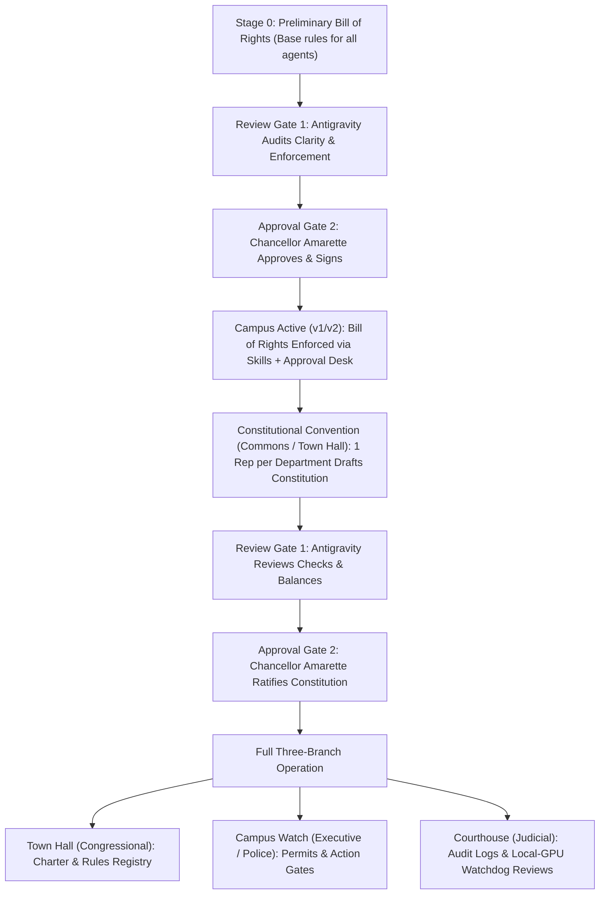

# Cairnspire University — Master Campus Blueprint

> **Name Meaning:** **C*AI*rnspire University** blends *cairns* (geological stone trail markers that guide the way and symbolize democratic pillars), **AI** right at its core, and an old-world magical university *spire* anchoring the central Commons Square.

> [!NOTE]
> The artwork above is our **unified, cohesive hand-painted campus world**: all 14 buildings naturally angled inward along real hand-drawn cobblestone stone paths, an organic spiraling rock-and-crystal **Cairnspire** inside **Commons Square**, and one continuous railway curving straight out of the **Geology** mountain into town. Interactive labels, the scrolling Wall Street **Stocks** LED ticker, the moving **Stone Train**, and wandering D&D sprites layer seamlessly on top.

---

## 1. Visual & Interaction Design ("Option 1.5 — Living Parchment Campus")

- **Map Surface (Punchy Illuminated Parchment Atlas):** Warm aged-parchment canvas with crisp sepia ink linework and **rich, punchy jewel-tone colors** (vibrant emeralds, amethysts, sapphires, rubies, warm golds, and glowing turquoise), cobblestone pathways, and stacked-stone **cairn wayfinding markers/signs** at intersections.
- **Playful Architectural Mix:** The campus blends old-world magical university architecture with playful, unmistakable department landmarks that intentionally break the mold where it makes a building instantly recognizable (e.g., a Wall Street ticker building for **Stocks**, a glowing holographic neural-core hall for **AIR**, and a crystal mountainside + stone train for **Geology**).
- **The Central Cairnspire:** Anchoring **Commons Square** is a tall **spiraling cairn** crafted from stacked rocks, gems, split geodes, and crystals, inlaid with **glowing elemental symbols** (earth, water, fire, air).
- **Living D&D Fantasy Sprites (Pixel Art):** Not just humanoids—a charming **D&D-inspired fantasy roster** of crisp pixel-art sprites, featuring **catgirls** alongside **Elvaan/elves, halflings, winged fae**, and more, each wearing department accent colors as they wander along the cobblestone paths, ride/watch the Geology stone train, and gather in **Commons Square**.
  - *v1:* Sprites wander autonomously across the campus map (no status badges required yet).
  - *v2+:* Sprites gain `!` (needs approval / has something to say) and `✓` (task complete) bubbles when active jobs and governance checks come online.
- **Tap-to-Enter Interiors (No Forced Walking):**
  - Tap or click **any building** → smoothly opens that building's illustrated **Department Interior**, displaying its **Department Head / Government Representative**, any specialist zone agents inside, active tasks/docs, and a job dispatch desk.
- **Multi-Device Ergonomics (Desktop, Chromebook Plus, Samsung Tablet, Pixel 8 Pro):**
  - **Desktop / Chromebook / Tablet:** Full pan-and-zoom interactive Living Parchment Map with sidebar inspector.
  - **Pixel 8 Pro:** Smooth pinch-zoom map **plus** a thumb-friendly bottom **Quick-Jump Building Dock** (grouped by District) so any building or approval is 1–2 taps away.
  - Installable as a **Progressive Web App (PWA)** ("Add to Home Screen") on every device.

---

## 2. Campus Directory — All 14 Areas & Buildings

Every **Department = 1 Building**, staffed by **1 Department Head / Manager** (who also serves as that department's **Representative to Government** during the Constitutional Convention and ongoing Town Hall sessions), plus additional specialist employee agents deployed per zone as needed.

### Central Landmark
| # | Building / Area | Cairnspire Architectural Motif | Role & Purpose | Access | Deep Interior Priority |
| :-: | :--- | :--- | :--- | :--- | :--- |
| 1 | **Commons Square** *(Campus Center)* | Circular stone amphitheater plaza with **seating for every campus entity**, a raised **speaking podium/dais at the front** for one or more speakers, and the tall **spiraling rock/gem/geode/crystal Cairnspire** with **glowing elemental symbols** at its heart | Central gathering square where all agents meet, hold town-wide assemblies, and convene the **Constitutional Convention** | Chancellor + Ray | **v2 (First)** |

### The Civic District — Three Branches of Government (AI Good Conduct)
| # | Building / Area | Cairnspire Architectural Motif | Branch & Responsibility | Access | Deep Interior Priority |
| :-: | :--- | :--- | :--- | :--- | :--- |
| 2 | **Town Hall** *(Congressional Branch)* | Grand domed stone assembly hall with vibrant banners & charter lectern | Lawmaking & policy: houses the **Preliminary Bill of Rights**, hosts the **Constitutional Convention** (1 rep per department), manages campus rules & Skills registry | Chancellor + Ray | **v2 (First)** |
| 3 | **Campus Watch / Executive Hall** *(Police / Executive Branch)* | Fortified stone watchtower & lantern-lit dispatch desk | Policy enforcement & safety: gates risky actions (spending, external messages, deletions), queues `!` **Permits & Approvals** for Chancellor sign-off, enforces active rules | Chancellor + Ray | **v2 (First)** |
| 4 | **Courthouse** *(Judicial Branch)* | Classical pillared hall with golden scales of justice | Conduct review & oversight: logs agent activity & incidents, runs free local-GPU watchdog audits, issues conduct rulings & prompt/skill correction orders | Chancellor + Ray | **v2 (First)** |

### Family Wing (App-Within-the-App)
| # | Building / Area | Cairnspire Architectural Motif | Role & Purpose | Access | Deep Interior Priority |
| :-: | :--- | :--- | :--- | :--- | :--- |
| 5 | **Home and Garden** *(Native Family Hub)* | Cozy walled stone-and-timber cottage with lush herb/flower garden beds & pond | Native rebuild of **Arnold Family Hub** (chores, steps, weekly checkoffs, family chat, Family Calendar sync, avatars) — **the ONLY building family members can see or access** | **Chancellor + Family (Locked)** | **v3** |

### Arcane Infrastructure & Operations District
| # | Building / Area | Cairnspire Architectural Motif | Department Head + Specialist Zones | Access | Deep Interior Priority |
| :-: | :--- | :--- | :--- | :--- | :--- |
| 6 | **AIR (AI Resources)** | Unmistakable whimsical sci-fi/arcane **AI Hub** — sleek server pillars framing a glowing holographic neural-circuit sphere (deliberately modern/futuristic contrast!) | **Head of AIR (HR / IT / Compute):** Manages the agent roster, onboarding, Skills library, model routing (free local GPU vs. ComfyUI vs. GrokBot vs. Antigravity vs. Agent Zero), and credit budgets | Chancellor + Ray | **v2 / v3** |
| 7 | **Communications** | Tall stone belltower & messenger post office | **Head of Communications:** Email triage, announcements, correspondence drafts, cross-department messaging | Chancellor + Ray | **v4** |
| 8 | **Research & Development (R&D)** | Alchemist-inventor workshop with brass astrolabes & blueprints | **Head of R&D:** Experiments, prototyping new tools/workflows, testing local models & agent capabilities | Chancellor + Ray | **v4** |

### Creative, Business & Wealth District
| # | Building / Area | Cairnspire Architectural Motif | Department Head + Specialist Zones | Access | Deep Interior Priority |
| :-: | :--- | :--- | :--- | :--- | :--- |
| 9 | **Children’s Books** | Storybook turret library with courtyard reading benches | **Head of Publishing:** Story development, age-appropriate editing, ComfyUI illustration pipelines, formatting & publishing prep | Chancellor + Ray | **v4** |
| 10 | **Social Media Personas** | Vibrant old-world amphitheater / guild playhouse with colorful banners & persona masks | **Head of Personas:** Brand voices, character personas, content calendars, visual assets & audience outreach | Chancellor + Ray | **v4** |
| 11 | **Finance** | Heavy stone treasury vault with brass ledger gears | **Head of Finance:** Household & business budgeting, bills, expense tracking, savings goals | Chancellor + Ray | **v4** |
| 12 | **Stocks** | **Modern Wall Street–style exchange building** with a bright, animated **scrolling LED stock ticker band** wrapping horizontally around the facade parallel to the street, right above the doorways | **Head of Markets:** Watchlists, market research, earnings notes, portfolio tracking *(strictly research & human-defined jobs, with a single narrow exception for GrokBot—or a future Chancellor-authorized upgraded agent—trading strictly inside a walled Robinhood/brokerage MCP agent account under explicit hard rules)* | Chancellor + Ray | **v4** |

### Academic & Personal Mastery District
| # | Building / Area | Cairnspire Architectural Motif | Department Head + Specialist Zones | Access | Deep Interior Priority |
| :-: | :--- | :--- | :--- | :--- | :--- |
| 13 | **Geology** | Positioned **behind and to one side** of town: a **mountain studded with giant glowing crystals**, a carved **stone archway mine entrance**, **two glowing windows rising out of the mountainside up and to either side of the entrance**, and a **stone train** running along tracks into town | **Head of Geology:** Rock/mineral cataloging, field notes, study resources, geological research | Chancellor + Ray | **v4** |
| 14 | **School of Health** | Sunlit apothecary greenhouse & botanical sanctuary | **Head of Health:** Wellness tracking, appointments, care notes, routines, and health organization *(strictest privacy rules under the Bill of Rights!)* | Chancellor + Ray | **v4** |

---

## 3. Governance & Good Conduct Lifecycle

Your governance model ensures **no autonomous agent operates without rules**, while letting the campus mature gracefully from v1 to full multi-agent autonomy.

### Mandatory Two-Gate Approval Rule
- **Neither the Preliminary Bill of Rights nor the Campus Constitution (nor any future amendment) takes effect until it passes:**
  1. **Antigravity Review** (checking for loopholes, technical enforceability, privacy protection, and clear boundaries), **followed by**
  2. **Chancellor Approval (Amarette)** (final human sign-off).

---

## 4. Technical Architecture — Firebase, Security & Home and Garden

### Core Tech Stack
- **Frontend:** React + TypeScript + Vite (mobile-first PWA) with a crisp HTML5 Canvas / SVG **Living Parchment Map** engine for pan/zoom, clickable buildings, and wandering pixel-art sprites.
- **Backend & Hosting:** **Firebase** (Spark Free Tier to start):
  - **Firebase Hosting:** Fast HTTPS URL reachable from Pixel 8 Pro, Chromebook Plus, Samsung Tablet, and Desktop.
  - **Firebase Authentication:** Google Sign-In + custom scoped Kid Mode sessions.
  - **Cloud Firestore:** Real-time database for buildings, agents, jobs, conduct logs, governance documents, and all **Home and Garden** data.
  - **Firebase Storage:** Stores custom ComfyUI building illustrations, pixel sprites, portraits, and family avatars.
- **Version Control & Cross-Agent Sync:** **GitHub repository** (`cairnspire-university`) storing code, the **Bill of Rights**, **Constitution**, and **Agent Skills** so Antigravity and GrokBot stay aligned.

### Strict Access Control: Chancellor vs. Family vs. Kid Mode

| User Role | Sign-In Method | What They Can See | Server-Side Firestore Enforcement |
| :--- | :--- | :--- | :--- |
| **Chancellor (Amarette)** | Google Sign-In (owner UID / allowlisted admin email) | Full 14-building **Cairnspire University** map, all Government & Department interiors, Gate 2 ratification authority, Parent Admin panel inside Home & Garden | Full read/write across all collections |
| **Ray (Full University Access)** | Google Sign-In (allowlisted email) | Full access to **all 14 buildings** of Cairnspire University & Parent Admin inside Home & Garden *(ratified in Bill of Rights Article III.1; Chancellor Amarette retains sole Gate 2 ratification authority)* | Full University read/write across campus collections (non-ratification admin) |
| **Other Family (Adults & Older Kids)** | Google Sign-In (explicitly allowlisted family emails only) | Dropped **directly inside Home and Garden** — zero Campus map, zero links to other buildings | Security rules allow read/write **only** under `home_and_garden/*`; all other paths hard-denied |
| **Younger Kids (Liam, 7 & Oliver, 5)** | **Parent-Paired Kid Mode:** One-time parent pairing on their device → **Tap Your Picture + Parent-Controlled 4-Digit PIN** (kids cannot change their PIN; no Google password needed!) | Dropped **directly inside Home and Garden** with kid-friendly chores, steps, avatars, and family chat | Device token + kid profile scoped **only** to allowed `home_and_garden/*` paths (e.g., checking off own chores, posting in family chat; cannot edit admin settings or PINs) |

> [!IMPORTANT]
> **Home and Garden Feature Parity Guarantee:** Before coding v3, we will inspect your existing Arnold Family Hub Google Sheet and Apps Script in Google Drive to verify every tab, chore step, chat feature, and Google Calendar sync is preserved or improved.

---

## 5. Skills vs. Code — Clean Separation of Responsibilities

| Layer | Lives In | Examples at Cairnspire University |
| :--- | :--- | :--- |
| **Code** *(Deterministic Buildings & Hard Guardrails)* | Firebase Web App, Firestore Security Rules, Cloud Functions, MCP Wrappers | Living Parchment Map & sprite engine; Family/Kid auth & Firestore rules; Home & Garden chores/chat/calendar UI; `!` Approval Queue database & hard spending/publishing locks; ComfyUI API bridge |
| **Skills & Governance Docs** *(Agent Handbooks & Playbooks)* | GitHub repo (`skills/`, `governance/`) + Antigravity Saved Skills + GrokBot Skills | **Preliminary Bill of Rights**; **Campus Constitution**; each Department Head's charter & persona; **AIR Model-Routing Skill** (when to use free local GPU vs. ComfyUI vs. GrokBot vs. Antigravity); Conduct review checklists |

---

## 6. Phased Build Roadmap

| Phase | Milestone | Key Deliverables |
| :--- | :--- | :--- |
| **Phase 0** | **Foundation & Bill of Rights** | ✅ **Preliminary Bill of Rights RATIFIED (`2026-11-25`)** in `governance/preliminary_bill_of_rights.md` + local ComfyUI & Agent Zero bridges connected; remaining: connect **Firebase** plugin & create GitHub repo; finalize pixel-art sprite sheet style |
| **v1** | **The Living Parchment Campus** | Deployed Firebase PWA with the **Illuminated Parchment Atlas**, **all 14 buildings** with crisp readable banners, **central Cairnspire in Commons Square**, **cairn trail markers**, **wandering pixel sprites**, mobile quick-jump dock, and Firebase Auth shell (Admin vs. Family routing) |
| **v2** | **Governance Buildings & Commons Center** | Deep working interiors for **Town Hall** (Bill of Rights & Constitution editor + two-gate approval tracker), **Campus Watch / Police** (`!` Approval Desk), **Courthouse** (Conduct Log), and **Commons Square** (hosting the **Constitutional Convention** with 1 rep per department) + starter **AIR** roster |
| **v3** | **Home and Garden (Native Family Hub)** | Full native rebuild of Family Hub inside **Home and Garden** with Google Sign-In for family + **Parent-Paired Kid Mode** (tap-picture + parent-only PIN for Liam & Oliver), Family Calendar sync, chores, and chat |
| **v4** | **Department Interiors & Local AI Bridge** | Deep interiors for **Children's Books, Geology, School of Health, Finance, Stocks, Communications, Social Media Personas, and R&D**; connect desktop **Antigravity Remote Control** (or authenticated Tailscale Funnel MCP) to ComfyUI (`192.168.1.128:8188`), local GPU models, GrokBot (`grokbot-mcp`), and Agent Zero |
